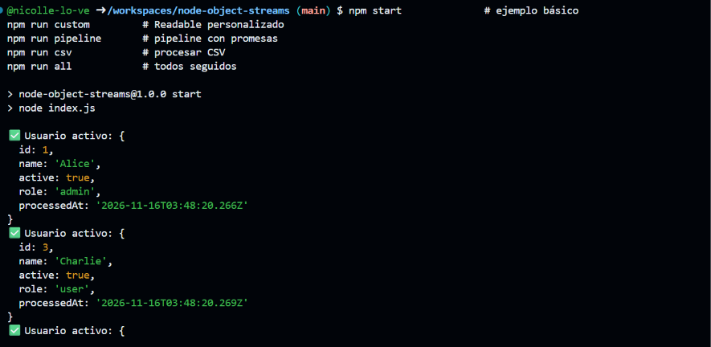
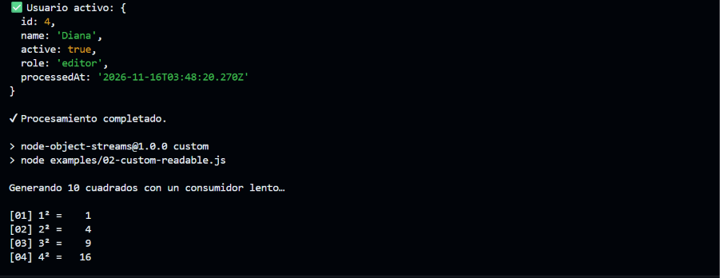
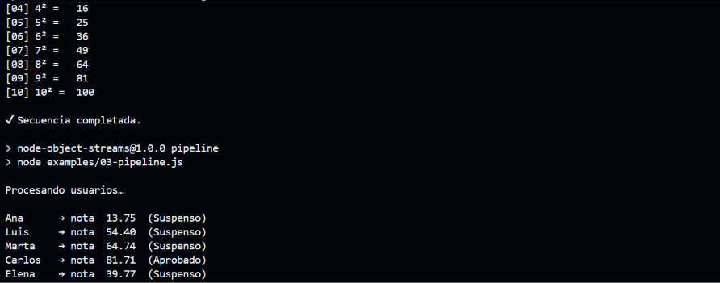
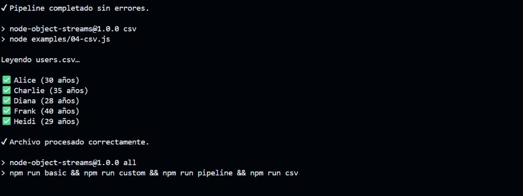
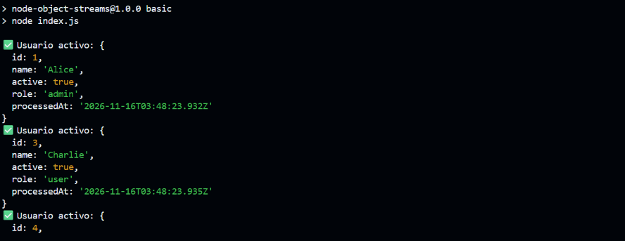
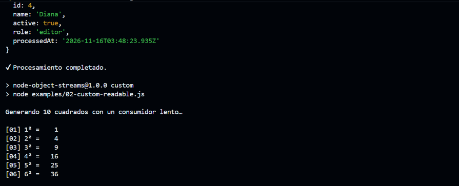
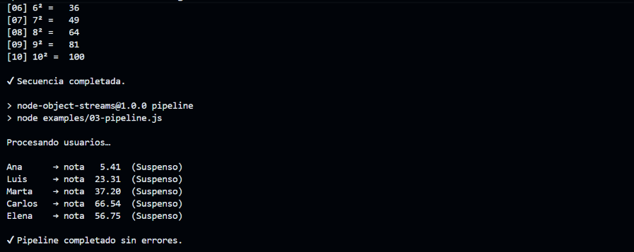

# 🌊 Node.js Object Streams

Ejemplos educativos de **streams de objetos** (`objectMode`) en Node.js. Cada ejemplo es autónomo y muestra un aspecto distinto: creación, transformación, backpressure, pipelines modernos y procesamiento de archivos.


---

## 🧐 ¿Qué es `objectMode`?

Por defecto, los streams en Node.js operan con **`Buffer`** (datos binarios) o **`string`**. La opción `objectMode: true` **desactiva esa restricción** y permite que cada *chunk* del stream sea **un objeto JavaScript completo** (objeto, array, número, `Map`, etc.).

```javascript
const stream = new Transform({
  objectMode: true, // 👈 clave
  transform(obj, _enc, cb) {
    cb(null, { ...obj, extra: 'algo' });
  },
});
```

### Variantes útiles

| Opción | Para qué sirve |
|---|---|
| `objectMode: true` | Afecta a lectura **y** escritura |
| `readableObjectMode: true` | Solo la parte **leíble** del stream |
| `writableObjectMode: true` | Solo la parte **escribible** del stream |
| `highWaterMark: N` | Cuántos objetos se bufferizan antes del backpressure |

---

## 📁 Estructura del proyecto

```
.
├── index.js                    ← Ejemplo básico (Readable → Transform → Writable)
├── examples/
│   ├── 02-custom-readable.js   ← Readable personalizado + backpressure
│   ├── 03-pipeline.js          ← Pipeline con promesas y async generators
│   └── 04-csv.js               ← Procesar un CSV línea a línea
├── data/
│   └── users.csv
├── package.json
├── LICENSE
└── README.md
```

---

## 🚀 Instalación y ejecución

No requiere dependencias externas (solo Node.js >= 16).

```bash
git clone https://github.com/<tu-usuario>/node-object-streams.git
cd node-object-streams
```

Y luego, a elegir:

| Comando | Ejecuta | Descripción |
|---|---|---|
| `npm start` (o `node index.js`) | `index.js` | Ejemplo básico con 3 etapas |
| `npm run custom` | `examples/02-custom-readable.js` | Readable personalizado con backpressure |
| `npm run pipeline` | `examples/03-pipeline.js` | Pipeline con `stream/promises` y `async function*` |
| `npm run csv` | `examples/04-csv.js` | Procesamiento de un archivo CSV |
| `npm run all` | Todos en orden | Ejecuta los 4 ejemplos seguidos |

---

## 📖 Ejemplo 1 — Básico (`index.js`)

**Cadena:** `Readable.from(array)` → `Transform` (filtra activos) → `Writable` (imprime).

```javascript
const { Readable, Transform, Writable, pipeline } = require('node:stream');

const source = Readable.from([
  { id: 1, name: 'Alice', active: true },
  { id: 2, name: 'Bob',   active: false },
]);

const filterActive = new Transform({
  objectMode: true,
  transform(user, _enc, cb) {
    if (user.active) cb(null, user);
    else cb();
  },
});

const sink = new Writable({
  objectMode: true,
  write(user, _enc, cb) {
    console.log(user);
    cb();
  },
});

pipeline(source, filterActive, sink, (err) => {
  if (err) console.error(err);
});
```

**Salida:**

```
✅ Usuario activo: { id: 1, name: 'Alice', active: true, processedAt: '...' }
✔ Procesamiento completado.
```

---

## 📖 Ejemplo 2 — `Readable` personalizado + backpressure

Se implementa `_read()` para generar datos bajo demanda. El consumidor es **lento** (200 ms por chunk) y `highWaterMark: 1` obliga al `Readable` a pausarse para no llenar la memoria. Esta es la esencia del **backpressure automático** de Node.js.

**Salida:**

```
Generando 10 cuadrados con un consumidor lento…

[ 1] 1² =    1
[ 2] 2² =    4
[ 3] 3² =    9
...
✔ Secuencia completada.
```

---

## 📖 Ejemplo 3 — Pipeline con promesas

Usa `node:stream/promises` para manejar el pipeline con `async/await`, y un `async function*` como fuente de datos. Ideal para fuentes que ya son asíncronas (APIs, bases de datos).

```javascript
const { pipeline } = require('node:stream/promises');

await pipeline(
  Readable.from(userGenerator()),
  gradeAssigner,
  tablePrinter
);
```

**Salida:**

```
Ana      → nota  42.18  (Suspenso)
Luis     → nota  87.34  (Aprobado)
...
✔ Pipeline completado sin errores.
```

---

## 📖 Ejemplo 4 — Procesar un CSV

Lee `data/users.csv` línea a línea, **parsea cada línea a un objeto**, filtra los activos y los imprime. Es el ejemplo más cercano a un caso real: procesar archivos grandes sin cargarlos completos en memoria.

**Cadena:**

```
fs.ReadStream  →  readline  →  Readable.from()
   →  Transform: parsear línea   →  Transform: filtrar
     →  Writable: imprimir
```

**Salida:**

```
Leyendo users.csv…

✅ Alice (30 años)
✅ Charlie (35 años)
✅ Diana (28 años)
✅ Frank (40 años)
✅ Heidi (29 años)

✔ Archivo procesado correctamente.
```

---

## 🔑 Conceptos clave

| Concepto | Explicación |
|---|---|
| **`objectMode: true`** | Permite que `chunk` sea cualquier objeto JS |
| **`Readable.from()`** | Convierte arrays o iterables en streams de objetos |
| **`Transform`** | Recibe un objeto, decide qué hacer (`push` / descartar / error) |
| **`this.push(null)`** | Señal de **EOF** (fin del stream) |
| **`highWaterMark`** | Controla cuántos objetos se acumulan antes del backpressure |
| **`pipeline`** | Conecta streams y propaga errores + destruye todo si falla |
| **`stream/promises`** | Versión con `async/await` del pipeline |
| **Backpressure** | El consumidor marca el ritmo; el productor se pausa si va muy rápido |

---

## ⚠️ Buenas prácticas

1. **Siempre usa `pipeline`** en lugar de `.pipe()`. `pipe()` no propaga errores ni destruye los streams cuando uno falla.
2. **`objectMode` no es gratis**: añade overhead. Úsalo solo cuando necesites objetos, no para buffers grandes de datos.
3. **No mezcles tipos**: si un stream está en `objectMode`, todo lo que pase por él debe ser objeto (incluida la "cadena vacía" que se convierte en `null` al final).
4. **Maneja errores siempre**: un `Transform` debe llamar a `callback(error)` cuando algo falla.
5. **Cierra los streams**: si abres un archivo con `fs.createReadStream`, asegúrate de que el pipeline lo cierra correctamente (lo hace automáticamente).

---

## 🧯 Problemas frecuentes

| Síntoma | Causa | Solución |
|---|---|---|
| `TypeError: Invalid non-string/buffer chunk` | El destino **no** está en `objectMode` | Añade `objectMode: true` al Writable/Transform |
| Pipeline nunca termina | Falta `this.push(null)` o `cb()` | Comprueba que cada Transform llame a su `callback` |
| Memoria disparada | No hay backpressure | Usa `highWaterMark` o un consumidor más lento |
| `ERR_STREAM_PREMATURE_CLOSE` | Se cerró el stream a medias | Usa `pipeline` en lugar de `.pipe()` |

---

## 🖥️ Ejecutar en Codespaces

1. **Botón verde `<> Code` → Codespaces → Create codespace on main**.
2. En la terminal integrada:

   ```bash
   npm start
   # o cualquier otro: npm run custom / pipeline / csv / all
   ```

No hace falta servidor HTTP: los ejemplos se ejecutan por terminal (`console.log`).

---

## Capturas









---

## 👤 Autor

**Nicolle Andrea Lozano Vega**
- GitHub: [@nicolle-lo-ve](https://github.com/nicolle-lo-ve)
